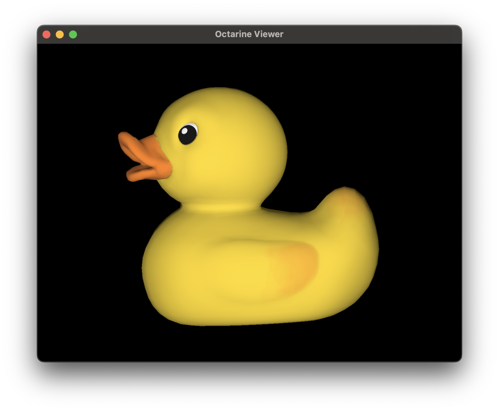
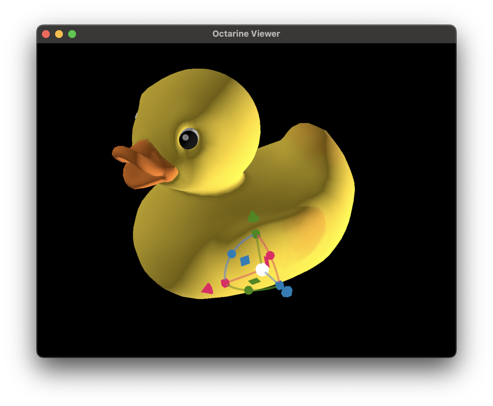

# Managing objects

## Accessing objects

As you add objects to the [octarine.Viewer][], you might want to keep track of
them so you can e.g. colorize or remove them at a later point.

Unless specified, each object gets a generic identifier:

```python
>>> duck = tm.load_remote(
...         'https://github.com/mikedh/trimesh/raw/main/models/Duck.glb'
...     )

>>> # Add the duck
>>> v.add_mesh(duck)
```



Let's check what objects are there:

```python
>>> v.objects
OrderedDict([('Object', [<pygfx.Mesh at 0x37f4f8b90>])])
```

The `.objects` property will return a dictionary mapping IDs to `pygfx` visuals.

Alternatively, you can also do this:

```python
>>> v['Object']
[<pygfx.Mesh at 0x37f4f8b90>]
```

Instead of generic IDs, we can also explicitly set the ID:

```python
>>> v.add_mesh(duck, name='Duck')
>>> v.objects
OrderedDict([('Duck', [<pygfx.Mesh at 0x37f5f8a12>])])
```

This can also be used to combine multiple objects under the same ID.

## Grouping objects

In addition to their ID, objects can be assigned to a `group`:

```python
>>> v.add_mesh(duck, name='Duck', group='Birds')
>>> v.add_mesh(bunny, name='Bunny', group='Mammals')
```

Groups currently serve two purposes:

1. The [`octarine.Viewer.objects_grouped`][octarine.Viewer] property returns
   an ordered dictionary mapping group names to object IDs (ungrouped
   objects are omitted):

    ```python
    >>> v.objects_grouped
    OrderedDict([('Birds', ['Duck']), ('Mammals', ['Bunny'])])
    ```

2. In the [control panel](controls.md#gui-controls), grouped objects appear
   as collapsible legend entries which you can show/hide or colorize as one.

## Modifying objects

Why are the object IDs discussed above relevant? Well, they help you manipulate
objects after they've been added:

```python
>>> v.set_colors({'Duck': 'w'})
>>> v.hide_objects('Duck')
>>> v.remove_objects('Duck')
```

You can also temporarily highlight objects by brightening their color:

```python
>>> v.highlight_objects('Duck')         # brighten by a default amount
>>> v.highlight_objects('Duck', color='red')  # ... or use an explicit color
>>> v.unhighlight_objects()             # remove all highlights
```

## Pinning objects

Pinned objects ignore changes to their color, visibility or transparency:

```python
>>> v.pin_objects('Duck')
>>> v.set_colors('red')   # this will not affect the pinned duck
>>> v.unpin_objects()     # unpin all objects again
```

This is useful when you want to keep e.g. reference objects fixed while
restyling or cycling through the rest. Use the `Viewer.pinned` property to
check which objects are currently pinned.

## Merging objects

Every object in a scene costs the renderer a fixed slice of CPU time per frame:
it is walked, its transform and uniforms are refreshed, it is depth-sorted and
it is submitted as a draw call of its own. None of that scales with how much
geometry the object holds, so a few hundred small objects cost far more than
one large one.

Merging trades them for a handful of shared objects. Set `merge` on the viewer
and it happens automatically, just before the next frame:

```python
>>> v = oc.Viewer(merge=True)       # merge whenever there is anything to merge
>>> v = oc.Viewer(merge=50)         # ... or only once there are 50+ objects
```

It can also be changed at any point, and takes effect straight away - turning
it off unmerges whatever is currently merged:

```python
>>> v.merge = True      # merge what is on the canvas now, and keep merging
>>> v.merge = False     # ... and back to one pygfx object per object
```

Crucially, the objects stay individually addressable. Everything in this page
works exactly as it does without merging:

```python
>>> v.hide_objects('neuron_1')
>>> v.set_colors({'neuron_1': 'red'})
>>> v.selected = ['neuron_1']
```

To see what it bought you:

```python
>>> v.merge_stats
MergeStats(objects=500, visuals=1, members=500, largest=500, split_outs=0)
```

`objects` is what you added, `visuals` is how many pygfx objects the renderer
actually walks - the number merging exists to bring down.

### What can and cannot be merged

Only meshes, lines and points are merged; volumes, tubes and text are left
alone. Two objects can share one pygfx object when they agree on everything
that object can hold only once - the material's blend and depth state, the
transform, the render order. Color, line width and point size are the
exceptions: where objects differ on those, the values move into the geometry,
which is why a merged scene can still show every object in its own color.

Anything a merged object *can't* hold per object - a silhouette, a matcap, a
blend mode - makes that object split back out into a visual of its own,
automatically, so the operation still does what you asked:

```python
>>> v.set_silhouette(3, objects=['neuron_1'])   # neuron_1 is split out
>>> v.merge_stats.split_outs
1
```

A `split_outs` that climbs during normal use means the merge is being eroded
object by object. If that happens, it is usually better to keep those objects
out of the merge in the first place:

```python
>>> v.add_mesh(scaffold, name='scaffold', merge=False)
```

You can also merge and unmerge by hand:

```python
>>> v.merge_objects()                  # merge what can be merged, now
>>> v.unmerge_objects('neuron_1')      # split one object back out
>>> v.unmerge_objects()                # ... or all of them
```

!!! note "Objects become handles"

    While merged, `Viewer.objects` reports a lightweight handle per object
    rather than the pygfx visual itself, since there is no longer one visual
    per object. Handles behave like visuals for everything octarine does with
    them, but they are not `pygfx.Mesh` instances - so code of your own that
    does `isinstance(vis, gfx.Mesh)` on `Viewer.objects` needs
    `handle.visual` to get at the merged object it lives in. This is why
    merging is off by default.

### Current limitations

**Object-level properties are not per-object.** Colour and visibility are, and
so is anything the viewer's own methods reach (`set_silhouette` and friends
split the object out for you). But writing a pygfx property straight onto a
handle - a transform, a render order - does *not* take effect, and does not
raise either:

```python
>>> v.objects['neuron_1'][0].render_order = 2   # silently has no effect
```

Nor can a merged object be driven by the transform gizmo; `Viewer.moveable_object`
will refuse a handle. Unmerge first if you need either:

```python
>>> v.unmerge_objects('neuron_1')
>>> v.moveable_object = 'neuron_1'
```

**Building a scene object-by-object *while it redraws* is slow.** Merging runs
once per frame, so a plain loop costs one merge pass no matter how many
objects it adds:

```python
>>> for m in meshes:        # 800 objects, one merge pass, ~0.3 s
...     v.add_mesh(m)
```

Add them one at a time with a frame drawn in between, though - a cell per
object in Jupyter, or a GUI you are interacting with - and each frame
re-merges the whole canvas to fold in the one new object: ~4 s for the same
800, and worse from there. Adding in bulk and letting the viewer merge once
avoids it entirely; so does `merge=False` while you build, followed by
`Viewer.merge_objects()`.

## Moving objects interactively

You can designate a single object to be moved interactively:

```python
>>> v.moveable_object = "Duck"
```



To remove the transform widget again simple do:

```python
>>> v.moveable_object = None
```


## What next?

<div class="grid cards" markdown>

-   :material-cube:{ .lg .middle } __Objects__

    ---

    Manipulate viewer and objects (color, size, visibility, etc).

    [:octicons-arrow-right-24: Viewer Controls](controls.md)

-   :material-select:{ .lg .middle } __Selection__

    ---

    Selecting objects on the viewer.

    [:octicons-arrow-right-24: Selection](selections.md)

</div>

